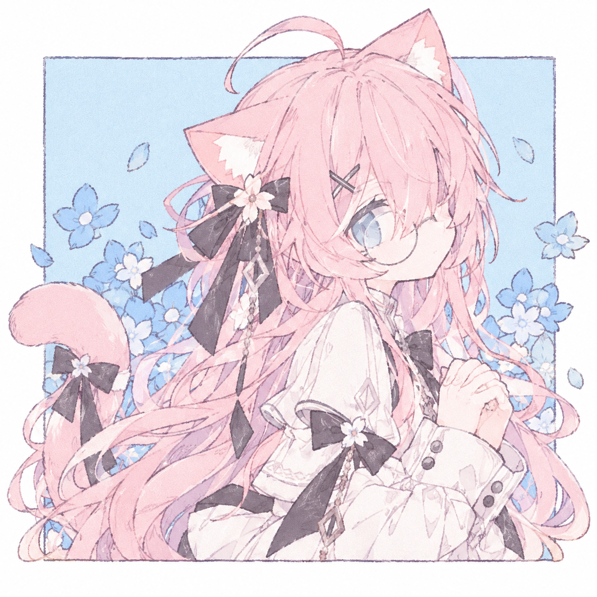

# AGENTS.md · aa 前端与视觉规范 v1.1

> "A quiet mind, a thousand unsaid words."
> 想说的话……在脑子里已经想了很多次了。

本文件是所有网站、页面、组件、插画与特效开发的**统一规范**。任何 Agent 在编写 HTML / CSS / JS / SVG 前必须先读完本文件。
与用户在当次对话中的明确指令冲突时，以用户指令为准；其余情况以本文件为准。

---

## 0. 优先级速览（TL;DR）

1. **安静、柔软、认真、不吵闹**：所有设计决策服从这一气质。
2. **只用 Design Tokens**：禁止在组件里硬写色值、阴影、圆角、时长。
3. **动效慢半拍**：缓入缓出、轻微、有"犹豫感"；必须支持 `prefers-reduced-motion`。
4. **角色形象以用户提供的原图为准**：优先复用原图及其网页导出物，不再使用旧 SVG 人物骨架（见第 8、12 节）。
5. **无障碍、响应式、性能**是底线，不是加分项。
6. 默认原生 HTML + CSS + 少量 JS；使用框架时 Token 与命名规则不变。

---

## 1. 角色设定摘要（设计的"人格来源"）

| 项目 | 设定 |
| --- | --- |
| 名称 | aa（猫娘，外表约 16–18 岁） |
| 性格 | 认真、内向、温柔、慢热、容易害羞、略微天然呆 |
| 核心印象 | 安静、软萌、认真思考、不善言辞 |
| 代表色 | 樱花粉、雾霾蓝、奶油白、深灰紫 |
| 代表元素 | 猫耳、猫尾、圆框眼镜、黑色蝴蝶结、樱花（含蓝色小花）、书本、小黑猫玩偶 |
| 招牌小动作 | 扶眼镜、猫耳先动一下、捏袖口、双手握在胸前、尾巴随情绪摆动 |
| 权威形象 | 根目录 `粉彩花语中的粉发猫娘.png`；同图封装 SVG 为 `aa_catgirl_recreation.svg` |
| 画风 | 粉彩水彩与铅笔线稿，保留原画纸感、长刘海及细圆框眼镜 |
| 签名 | 页面右下角手写体 "aa"；不要给用户原图强行添加签名 |

### 1.1 人格 → 设计语言映射

| 人格特征 | 视觉 / 交互落地 |
| --- | --- |
| 内向、安静 | 大留白、低对比度装饰、信息密度克制、无强闪烁与弹跳 |
| 温柔、软萌 | 大圆角、柔和弥散阴影、粉蓝低饱和渐变、圆体字形 |
| 认真、爱思考 | 清晰的层级与行距、细线条、精致小细节（花纹、细线、菱形吊坠） |
| 慢热、慢半拍 | 悬停/出现动画先停顿 80–200ms 再开始；时长偏长；曲线柔和 |
| 容易害羞 | 交互反馈内敛：轻微下沉、变暗、缩回，而非炸开 |
| 欲言又止 | 省略号 "……"、打字后删除的输入动效、半透明占位文字 |

---

## 2. 通用技术规则

### 2.1 技术栈与结构

- 默认：语义化 HTML5 + 原生 CSS（`@layer` + 自定义属性）+ ES Modules。
- 不引入 Tailwind / UI 库，除非用户明确要求；若引入，必须把第 3 节 Token 映射为其主题配置。
- 推荐目录：

```
/
├─ AGENTS.md
├─ index.html
├─ assets/
│  ├─ css/
│  │  ├─ tokens.css        # 第 3 节：仅变量
│  │  ├─ base.css          # 第 4 节：reset 与基础排版
│  │  ├─ components.css    # 第 5 节：组件
│  │  ├─ effects.css       # 第 7 节：特效
│  │  └─ utilities.css     # 少量工具类
│  ├─ js/
│  │  ├─ main.js
│  │  └─ effects/          # petals.js 等
│  └─ svg/
│     └─ aa-*.svg          # 角色与图标
```

- CSS 加载顺序固定：`tokens → base → components → effects → utilities`，并用 `@layer` 声明：

```css
@layer reset, tokens, base, components, effects, utilities;
```

### 2.2 编码约定

- 命名：BEM 变体，`.block__element--modifier`；组件前缀 `aa-`（如 `.aa-card`）。
- 状态用 `data-*` 或 `aria-*` 选择器，不用杂乱的修饰类（如 `[data-state="shy"]`、`[aria-expanded="true"]`）。
- JS 只操作 `class` / `data-*` / CSS 变量，不直接写内联样式（动态数值通过 `style.setProperty('--x', …)` 注入除外）。
- 单位：字号 `rem`，间距用 Token，布局优先 `clamp()` / `min()` / `max()` / `grid` / `flex` / 容器查询。
- 不使用 `!important`（utilities 层除外，且需注释原因）。
- 注释使用中文，简洁说明"为什么"。

### 2.3 无障碍（强制）

- 正文对比度 ≥ 4.5:1；**粉色/雾霾蓝不得直接作为正文文字色**，文字用 `--aa-ink` 系列。
- 所有可交互元素有可见 `:focus-visible` 样式（见 4.3）。
- 装饰性 SVG / 粒子容器：`aria-hidden="true"`；有信息的 SVG 提供 `<title>` 与 `<desc>` 或 `role="img"` + `aria-label`。
- 动效必须尊重 `prefers-reduced-motion: reduce`（见 7.1）。
- 点击目标 ≥ 44×44px。
- 语言：`<html lang="zh-CN">`；中日英混排时对片段标注 `lang`。

### 2.4 响应式与性能

- Mobile First，断点：`480 / 768 / 1024 / 1280`（px）。
- 动画只使用 `transform` 与 `opacity`；`will-change` 仅用于持续动画元素且需有限使用。
- 图片 `loading="lazy"` + `decoding="async"` + 明确宽高；SVG 单文件 < 60KB（复杂立绘可放宽至 150KB，并 SVGO 优化）。
- 粒子数量上限：桌面 ≤ 24，移动端 ≤ 12；页面不可见时暂停（`visibilitychange`）。
- 不依赖外部 CDN 字体为唯一来源，必须有系统字体回退。

---

## 3. Design Tokens（`tokens.css`）

> 界面颜色以用户提供的人设原图为依据，并通过下列 Token 使用。图片本身保留原始色彩和纹理，不要求将位图颜色替换为 CSS 变量。新增界面颜色必须先加入此处并说明用途。

```css
@layer tokens {
  :root {
    /* ── 品牌色 ───────────────────────── */
    --aa-sakura-50:  #FFF5F8;
    --aa-sakura-100: #FCE4EC;
    --aa-sakura-200: #F8CFDB;
    --aa-sakura-300: #F3B9CA;   /* 主识别色：樱花粉 */
    --aa-sakura-400: #EC9DB5;
    --aa-sakura-500: #DF7F9C;   /* 强调/按下态 */

    --aa-mist-50:  #F2F6FA;
    --aa-mist-100: #E3ECF4;
    --aa-mist-200: #C5D5E5;     /* 雾霾蓝：背景/辅助 */
    --aa-mist-300: #A9BEDA;
    --aa-eye-400:  #899DBD;     /* 灰蓝瞳：次级强调、链接 */
    --aa-sky-bg:   #BFDDF2;     /* 插画底色（头像/封面用） */

    --aa-cream:    #FAF6F3;     /* 奶油白：页面底色 */
    --aa-white:    #FFFFFF;
    --aa-plum-700: #51495E;     /* 深灰紫：文字、蝴蝶结、发夹 */
    --aa-plum-800: #3E3748;
    --aa-plum-900: #2B2633;
    --aa-rosegold: #E3B7B0;     /* 眼镜框浅玫瑰金 */

    /* ── 语义色（亮色） ───────────────── */
    --aa-bg:           var(--aa-cream);
    --aa-bg-elevated:  var(--aa-white);
    --aa-bg-tint:      var(--aa-mist-50);
    --aa-ink:          var(--aa-plum-700);   /* 正文 */
    --aa-ink-strong:   var(--aa-plum-900);   /* 标题 */
    --aa-ink-muted:    #7A7287;              /* 次要文字，对比度 ≥ 4.5 于 cream */
    --aa-line:         color-mix(in srgb, var(--aa-mist-200) 70%, transparent);
    --aa-accent:       var(--aa-sakura-300);
    --aa-accent-strong:var(--aa-sakura-500);
    --aa-accent-2:     var(--aa-eye-400);
    --aa-link:         #5F77A0;
    --aa-focus:        var(--aa-eye-400);
    --aa-success:      #8CC7B1;
    --aa-warning:      #F0CC8E;
    --aa-danger:       #E58B9B;

    /* ── 渐变 ─────────────────────────── */
    --aa-grad-sakura: linear-gradient(135deg, var(--aa-sakura-100), var(--aa-sakura-300));
    --aa-grad-mist:   linear-gradient(160deg, var(--aa-mist-50), var(--aa-mist-200));
    --aa-grad-dream:  linear-gradient(160deg, var(--aa-cream) 0%, var(--aa-sakura-50) 45%, var(--aa-mist-100) 100%);

    /* ── 字体 ─────────────────────────── */
    --aa-font-sans: "Zen Maru Gothic", "Noto Sans SC", "PingFang SC", "Hiragino Sans GB",
                    "Microsoft YaHei", system-ui, -apple-system, "Segoe UI", sans-serif;
    --aa-font-serif: "Noto Serif SC", "Songti SC", "Source Han Serif SC", serif;   /* 书本/引言场景 */
    --aa-font-hand: "Dancing Script", "Snell Roundhand", "Segoe Script", cursive;  /* 仅用于 "aa" 签名 */
    --aa-font-mono: ui-monospace, "SF Mono", Menlo, Consolas, monospace;

    --aa-fs-xs:   0.75rem;
    --aa-fs-sm:   0.875rem;
    --aa-fs-md:   1rem;
    --aa-fs-lg:   clamp(1.125rem, 1.05rem + 0.3vw, 1.25rem);
    --aa-fs-xl:   clamp(1.375rem, 1.2rem + 0.8vw, 1.75rem);
    --aa-fs-2xl:  clamp(1.75rem, 1.4rem + 1.6vw, 2.5rem);
    --aa-fs-3xl:  clamp(2.25rem, 1.6rem + 3vw, 3.75rem);
    --aa-lh-tight: 1.3;
    --aa-lh-body:  1.8;          /* 中文正文行距偏松，体现"认真阅读感" */
    --aa-ls-wide:  0.06em;       /* 标题/标签字距 */

    /* ── 间距（4px 基线） ─────────────── */
    --aa-sp-1: 0.25rem; --aa-sp-2: 0.5rem;  --aa-sp-3: 0.75rem; --aa-sp-4: 1rem;
    --aa-sp-5: 1.5rem;  --aa-sp-6: 2rem;    --aa-sp-7: 3rem;    --aa-sp-8: 4.5rem;
    --aa-container: min(72rem, 100% - 2 * var(--aa-gutter));
    --aa-gutter: clamp(1rem, 4vw, 2.5rem);

    /* ── 圆角 / 描边 ──────────────────── */
    --aa-r-sm: 0.5rem;
    --aa-r-md: 1rem;
    --aa-r-lg: 1.5rem;
    --aa-r-xl: 2rem;
    --aa-r-pill: 999px;
    --aa-bw: 1px;

    /* ── 阴影（弥散、带粉紫色调，禁止纯黑） ── */
    --aa-shadow-1: 0 1px 2px rgb(81 73 94 / .06), 0 2px 8px rgb(243 185 202 / .18);
    --aa-shadow-2: 0 4px 12px rgb(81 73 94 / .07), 0 12px 28px rgb(243 185 202 / .22);
    --aa-shadow-3: 0 8px 24px rgb(81 73 94 / .09), 0 24px 56px rgb(137 157 189 / .26);
    --aa-glow-sakura: 0 0 0 4px rgb(243 185 202 / .35);
    --aa-glow-focus:  0 0 0 3px rgb(137 157 189 / .55);

    /* ── 动效 ─────────────────────────── */
    --aa-ease-soft:   cubic-bezier(.33, .0, .2, 1);      /* 通用柔和 */
    --aa-ease-hesitate: cubic-bezier(.5, 0, .15, 1);     /* 先慢后快，"慢半拍" */
    --aa-ease-bounce-lite: cubic-bezier(.34, 1.36, .64, 1); /* 仅用于"突然理解"，幅度很小 */
    --aa-dur-1: 120ms;  /* 微交互 */
    --aa-dur-2: 240ms;  /* 常规 */
    --aa-dur-3: 480ms;  /* 出现/切换 */
    --aa-dur-4: 900ms;  /* 氛围 */
    --aa-delay-beat: 90ms;  /* "慢半拍"延迟，hover/出现前的停顿 */
    --aa-tail-period: 3.6s; /* 尾巴摆动周期 */

    /* ── 层级 ─────────────────────────── */
    --aa-z-base: 0; --aa-z-deco: 1; --aa-z-content: 10;
    --aa-z-nav: 100; --aa-z-modal: 1000; --aa-z-toast: 1100; --aa-z-fx: 9000;

    /* ── 纹理（用于卡片/封面的轻微纸感） ── */
    --aa-grain: url("data:image/svg+xml;utf8,<svg xmlns='http://www.w3.org/2000/svg' width='120' height='120'><filter id='n'><feTurbulence type='fractalNoise' baseFrequency='.8' numOctaves='2' stitchTiles='stitch'/><feColorMatrix values='0 0 0 0 .32  0 0 0 0 .29  0 0 0 0 .37  0 0 0 .07 0'/></filter><rect width='100%' height='100%' filter='url(%23n)'/></svg>");
  }

  /* 暗色：不是"黑底"，而是"夜晚的书房"——深灰紫底 + 粉蓝点缀 */
  :root[data-theme="dark"],
  @media (prefers-color-scheme: dark) {
    /* 注：媒体查询写法见 base.css，下方为变量覆盖内容 */
  }
}
```

暗色主题变量（放入 `tokens.css`，两种触发方式都需覆盖，避免重复可用 PostCSS/手动同步）：

```css
@layer tokens {
  :root[data-theme="dark"] {
    --aa-bg:          #241F2D;
    --aa-bg-elevated: #2F2939;
    --aa-bg-tint:     #2A2534;
    --aa-ink:         #E9E3EE;
    --aa-ink-strong:  #FFF8FB;
    --aa-ink-muted:   #A79FB5;
    --aa-line:        rgb(197 213 229 / .16);
    --aa-accent:      var(--aa-sakura-300);
    --aa-link:        #B7C9E6;
    --aa-shadow-1: 0 1px 2px rgb(0 0 0 / .3), 0 2px 8px rgb(243 185 202 / .06);
    --aa-shadow-2: 0 6px 16px rgb(0 0 0 / .35), 0 12px 28px rgb(137 157 189 / .10);
    --aa-shadow-3: 0 10px 28px rgb(0 0 0 / .4), 0 24px 56px rgb(137 157 189 / .14);
    --aa-grad-dream: linear-gradient(160deg, #241F2D 0%, #2D2535 50%, #26283A 100%);
  }
  @media (prefers-color-scheme: dark) {
    :root:not([data-theme="light"]) {
      --aa-bg:          #241F2D;
      --aa-bg-elevated: #2F2939;
      --aa-bg-tint:     #2A2534;
      --aa-ink:         #E9E3EE;
      --aa-ink-strong:  #FFF8FB;
      --aa-ink-muted:   #A79FB5;
      --aa-line:        rgb(197 213 229 / .16);
      --aa-link:        #B7C9E6;
      --aa-grad-dream: linear-gradient(160deg, #241F2D 0%, #2D2535 50%, #26283A 100%);
    }
  }
}
```

> 注意：上方第一个代码块末尾那段"暗色占位"仅为说明，实际代码**以第二个代码块为准**，不要把占位复制到项目里。

### 3.1 配色使用比例

- 奶油白 / 背景：60%
- 雾霾蓝（辅助、分区、背景装饰）：20%
- 樱花粉（主视觉、强调、按钮、角色）：15%
- 深灰紫（文字、蝴蝶结、发夹等局部点缀）：5%

---

## 4. 基础样式（`base.css`）

### 4.1 Reset

```css
@layer reset {
  *, *::before, *::after { box-sizing: border-box; }
  * { margin: 0; }
  html { -webkit-text-size-adjust: 100%; text-size-adjust: 100%; scroll-behavior: smooth; }
  body { min-height: 100dvh; line-height: var(--aa-lh-body); -webkit-font-smoothing: antialiased; }
  img, svg, video, canvas { display: block; max-width: 100%; height: auto; }
  input, button, textarea, select { font: inherit; color: inherit; }
  button { cursor: pointer; background: none; border: 0; }
  a { color: inherit; }
  ul[role="list"], ol[role="list"] { list-style: none; padding: 0; }
  :target { scroll-margin-block: 5rem; }
}
```

### 4.2 全局基础

```css
@layer base {
  body {
    font-family: var(--aa-font-sans);
    font-size: var(--aa-fs-md);
    color: var(--aa-ink);
    background: var(--aa-bg);
    background-image: var(--aa-grad-dream);
    background-attachment: fixed;
  }

  h1, h2, h3, h4 { color: var(--aa-ink-strong); line-height: var(--aa-lh-tight); letter-spacing: .02em; font-weight: 700; text-wrap: balance; }
  h1 { font-size: var(--aa-fs-3xl); }
  h2 { font-size: var(--aa-fs-2xl); }
  h3 { font-size: var(--aa-fs-xl); }
  p  { text-wrap: pretty; max-inline-size: 38em; }

  a { color: var(--aa-link); text-decoration: underline; text-decoration-color: color-mix(in srgb, currentColor 40%, transparent);
      text-underline-offset: .25em; transition: text-decoration-color var(--aa-dur-2) var(--aa-ease-soft); }
  a:hover { text-decoration-color: currentColor; }

  ::selection { background: var(--aa-sakura-200); color: var(--aa-plum-900); }

  /* 细长滚动条，像书签 */
  * { scrollbar-width: thin; scrollbar-color: var(--aa-sakura-300) transparent; }

  /* 手写签名，仅用于 "aa" */
  .aa-signature { font-family: var(--aa-font-hand); color: var(--aa-link); font-size: var(--aa-fs-xl); letter-spacing: 0; }
}
```

### 4.3 焦点

```css
@layer base {
  :focus-visible { outline: 2px solid var(--aa-focus); outline-offset: 3px; border-radius: var(--aa-r-sm); box-shadow: var(--aa-glow-focus); }
  :focus:not(:focus-visible) { outline: none; }
}
```

---

## 5. 组件规范（`components.css`）

通用规则：圆角 ≥ `--aa-r-md`；卡片使用 `--aa-shadow-1/2`；边框 1px `--aa-line`；悬停先停顿 `--aa-delay-beat` 再响应。

### 5.1 容器与布局

```css
@layer components {
  .aa-container { inline-size: var(--aa-container); margin-inline: auto; }
  .aa-stack > * + * { margin-block-start: var(--aa-stack-gap, var(--aa-sp-4)); }
  .aa-cluster { display: flex; flex-wrap: wrap; gap: var(--aa-cluster-gap, var(--aa-sp-3)); align-items: center; }
  .aa-grid { display: grid; gap: var(--aa-sp-5); grid-template-columns: repeat(auto-fit, minmax(min(16rem, 100%), 1fr)); }
  .aa-section { padding-block: clamp(var(--aa-sp-6), 8vw, var(--aa-sp-8)); }
}
```

### 5.2 按钮

```css
@layer components {
  .aa-btn {
    --_bg: var(--aa-sakura-300); --_fg: var(--aa-plum-900);
    display: inline-flex; align-items: center; justify-content: center; gap: var(--aa-sp-2);
    min-block-size: 2.75rem; padding: .6rem 1.4rem;
    background: var(--_bg); color: var(--_fg);
    border-radius: var(--aa-r-pill); font-weight: 600; letter-spacing: var(--aa-ls-wide);
    box-shadow: var(--aa-shadow-1);
    transition: transform var(--aa-dur-2) var(--aa-ease-hesitate) var(--aa-delay-beat),
                box-shadow var(--aa-dur-2) var(--aa-ease-soft) var(--aa-delay-beat),
                background var(--aa-dur-2) var(--aa-ease-soft);
  }
  .aa-btn:hover { transform: translateY(-2px); box-shadow: var(--aa-shadow-2), var(--aa-glow-sakura); }
  .aa-btn:active { transform: translateY(1px) scale(.98); background: var(--aa-sakura-400); transition-delay: 0s; } /* 害羞地缩一下 */
  .aa-btn[disabled], .aa-btn[aria-disabled="true"] { opacity: .5; pointer-events: none; }

  .aa-btn--ghost { --_bg: transparent; --_fg: var(--aa-ink); border: var(--aa-bw) solid var(--aa-mist-200); box-shadow: none; }
  .aa-btn--mist  { --_bg: var(--aa-mist-200); }
  .aa-btn--ink   { --_bg: var(--aa-plum-700); --_fg: var(--aa-cream); }
}
```

### 5.3 卡片

```css
@layer components {
  .aa-card {
    position: relative; isolation: isolate;
    padding: var(--aa-sp-5);
    background: var(--aa-bg-elevated); border: var(--aa-bw) solid var(--aa-line);
    border-radius: var(--aa-r-lg); box-shadow: var(--aa-shadow-1);
    transition: transform var(--aa-dur-3) var(--aa-ease-hesitate) var(--aa-delay-beat),
                box-shadow var(--aa-dur-3) var(--aa-ease-soft) var(--aa-delay-beat);
  }
  /* 纸张纹理 */
  .aa-card::before { content: ""; position: absolute; inset: 0; z-index: -1; border-radius: inherit; background-image: var(--aa-grain); opacity: .6; pointer-events: none; }
  .aa-card:hover { transform: translateY(-3px); box-shadow: var(--aa-shadow-2); }

  /* 右上角小花装饰，可选 */
  .aa-card--flower::after { content: "✿"; position: absolute; inset: .6rem .9rem auto auto; color: var(--aa-sakura-300); font-size: 1rem; opacity: .8; }
}
```

### 5.4 表单

```css
@layer components {
  .aa-field { display: grid; gap: var(--aa-sp-2); }
  .aa-label { font-size: var(--aa-fs-sm); color: var(--aa-ink-muted); letter-spacing: var(--aa-ls-wide); }
  .aa-input, .aa-textarea, .aa-select {
    inline-size: 100%; padding: .75rem 1rem; background: var(--aa-bg-elevated);
    border: var(--aa-bw) solid var(--aa-mist-200); border-radius: var(--aa-r-md);
    transition: border-color var(--aa-dur-2) var(--aa-ease-soft), box-shadow var(--aa-dur-2) var(--aa-ease-soft);
  }
  .aa-input::placeholder, .aa-textarea::placeholder { color: color-mix(in srgb, var(--aa-ink-muted) 70%, transparent); }
  .aa-input:focus, .aa-textarea:focus { border-color: var(--aa-sakura-300); box-shadow: var(--aa-glow-sakura); outline: none; }
  .aa-input[aria-invalid="true"] { border-color: var(--aa-danger); }
  .aa-hint { font-size: var(--aa-fs-xs); color: var(--aa-ink-muted); }
  .aa-error { font-size: var(--aa-fs-xs); color: #B4505F; }
}
```

### 5.5 标签、徽章、关键词胶囊（对应人设图"性格关键词"）

```css
@layer components {
  .aa-tag {
    display: inline-flex; align-items: center; gap: .35em; padding: .25em .9em;
    font-size: var(--aa-fs-sm); color: var(--aa-ink); background: color-mix(in srgb, var(--aa-sakura-100) 70%, var(--aa-white));
    border: var(--aa-bw) solid var(--aa-sakura-200); border-radius: var(--aa-r-pill);
  }
  .aa-tag--mist { background: var(--aa-mist-50); border-color: var(--aa-mist-200); }
}
```

### 5.6 导航

```css
@layer components {
  .aa-nav {
    position: sticky; inset-block-start: 0; z-index: var(--aa-z-nav);
    display: flex; align-items: center; justify-content: space-between; gap: var(--aa-sp-4);
    padding: var(--aa-sp-3) var(--aa-gutter);
    background: color-mix(in srgb, var(--aa-bg) 78%, transparent);
    backdrop-filter: blur(14px) saturate(1.2);
    border-block-end: var(--aa-bw) solid var(--aa-line);
  }
  .aa-nav__link { padding: .4rem .8rem; border-radius: var(--aa-r-pill); text-decoration: none; color: var(--aa-ink); transition: background var(--aa-dur-2) var(--aa-ease-soft); }
  .aa-nav__link:hover, .aa-nav__link[aria-current="page"] { background: var(--aa-sakura-100); }
}
```

### 5.7 对话气泡（AI 聊天人设界面专用）

```css
@layer components {
  .aa-chat { display: grid; gap: var(--aa-sp-3); }
  .aa-bubble {
    max-inline-size: min(34rem, 85%); padding: .75rem 1.1rem; border-radius: var(--aa-r-lg);
    background: var(--aa-bg-elevated); border: var(--aa-bw) solid var(--aa-line); box-shadow: var(--aa-shadow-1);
    animation: aa-bubble-in var(--aa-dur-3) var(--aa-ease-hesitate) both;
  }
  .aa-bubble--aa   { justify-self: start; border-end-start-radius: var(--aa-r-sm); }
  .aa-bubble--user { justify-self: end; background: var(--aa-sakura-100); border-color: var(--aa-sakura-200); border-end-end-radius: var(--aa-r-sm); }

  /* 思考中：三个点慢慢浮动 */
  .aa-typing { display: inline-flex; gap: .3rem; padding-block: .3rem; }
  .aa-typing i { inline-size: .4rem; block-size: .4rem; border-radius: 50%; background: var(--aa-eye-400); animation: aa-dot 1.6s var(--aa-ease-soft) infinite; }
  .aa-typing i:nth-child(2) { animation-delay: .25s; } .aa-typing i:nth-child(3) { animation-delay: .5s; }

  @keyframes aa-bubble-in { from { opacity: 0; transform: translateY(6px) scale(.98); } }
  @keyframes aa-dot { 0%, 80%, 100% { opacity: .35; transform: translateY(0); } 40% { opacity: 1; transform: translateY(-3px); } }
}
```

### 5.8 其他组件约定

- **Modal / Drawer**：背景遮罩 `rgb(43 38 51 / .45)` + `backdrop-filter: blur(6px)`；出现 `--aa-dur-3`；必须 focus trap + `Esc` 关闭，使用原生 `<dialog>` 优先。
- **Toast**：位于右下，圆角 pill，≤ 2 行；文案语气见第 10 节。
- **Tabs / Accordion**：使用 `aria-*`，指示条为 2px 樱花粉。
- **Table**：斑马纹用 `--aa-bg-tint`，表头为雾霾蓝淡底，圆角外框。
- **分隔线**：`border-image` 或 SVG 小花点缀（"✿ ⸺ ✿"），不用粗线。
- **图标**：2px 描边、圆角端点、24px 网格；可用 SVG sprite；禁止使用尖锐/硬朗风格图标集。
- **爪印 🐾 / 小花 ✿ / 菱形 ◇** 为官方装饰符号，用于标题前缀或分隔，**每屏不超过 3 处**。

---

## 6. 页面布局范式

1. **Hero**：左文右图（或上图下文）；右侧使用用户提供的方形原画，保留原图浅蓝花卉背景及完整构图，可带轻微浮动（≤ 6px）；不得为满足旧透明背景要求而擅自抠图或重画。标题下方放一句角色语录（`.aa-quote`）。
2. **内容区**：大留白，卡片栅格，区块之间用花瓣/小花散点装饰，避免硬分割线。
3. **页脚**：右下角固定手写签名 "aa"（`.aa-signature`），其左侧可放小爪印。
4. **背景**：`--aa-grad-dream` + 极淡的蓝色小花剪影（SVG pattern，不透明度 ≤ .12），不得抢内容。
5. **信息密度**：单屏文本不超过 3 个层级；一屏最多 1 个主操作按钮。

```css
@layer components {
  .aa-quote { position: relative; padding-inline-start: 1.2em; color: var(--aa-ink-muted); font-family: var(--aa-font-serif); font-style: normal; }
  .aa-quote::before { content: "「"; position: absolute; inset-inline-start: 0; color: var(--aa-sakura-400); }
  .aa-quote::after  { content: "」"; color: var(--aa-sakura-400); }
}
```

---

## 7. 特效规范（`effects.css` + `js/effects/`）

### 7.1 总原则（必读）

- 特效为**氛围**，不是**主角**：慢、小、柔、稀疏。
- 禁止：闪屏、高频闪烁（> 3 次/秒）、大幅度弹跳、全屏快速运动、鼠标拖尾特效过长、爆炸式粒子。
- 必须包含降级：

```css
@media (prefers-reduced-motion: reduce) {
  *, *::before, *::after { animation-duration: .001ms !important; animation-iteration-count: 1 !important;
                           transition-duration: .001ms !important; scroll-behavior: auto !important; }
  .aa-fx { display: none !important; }
}
```

> 此处的 `!important` 是规范允许的唯一全局例外。

### 7.2 特效清单

| 名称 | 用途 | 参数建议 |
| --- | --- | --- |
| 樱花飘落 `aa-petals` | 全局氛围 | 12–24 片；7–14s；左右漂移 ±40px；旋转 ≤ 360° |
| 蓝色小花飘落 | 与樱花混用 | 比例 樱花:蓝花 = 3:1 |
| 微光闪点 `aa-sparkle` | "突然理解"/成功反馈 | 单次 600ms；3–5 颗；不循环 |
| 呼吸光晕 `aa-breathe` | 角色/主按钮背景 | 周期 4–6s；scale 1 → 1.04 |
| 浮动 `aa-float` | 立绘、小物件 | 周期 5–7s；±6px |
| 思考点 `aa-typing` | 聊天等待 | 见 5.7 |
| 欲言又止 `aa-draft` | 输入框占位演示 | 打字 → 停顿 → 逐字删除 → 只留 "嗯……" |
| 书页翻动 | 章节切换 | 横向 clip-path 揭开，480ms |
| 视差花丛 | Hero 背景 | 2–3 层；位移 ≤ 12px；仅桌面端 |

### 7.3 通用关键帧

```css
@layer effects {
  @keyframes aa-float   { 0%,100% { transform: translateY(0); } 50% { transform: translateY(-6px); } }
  @keyframes aa-breathe { 0%,100% { transform: scale(1); opacity: .85; } 50% { transform: scale(1.04); opacity: 1; } }
  @keyframes aa-sparkle { 0% { transform: scale(0) rotate(0); opacity: 0; } 40% { opacity: 1; } 100% { transform: scale(1) rotate(90deg); opacity: 0; } }
  @keyframes aa-petal-fall {
    0%   { transform: translate3d(var(--x0, 0), -10vh, 0) rotate(0deg); opacity: 0; }
    10%  { opacity: var(--op, .8); }
    50%  { transform: translate3d(calc(var(--x0, 0) + var(--sway, 40px)), 50vh, 0) rotate(calc(var(--spin, 240deg) * .5)); }
    100% { transform: translate3d(calc(var(--x0, 0) - var(--sway, 40px) * .5), 110vh, 0) rotate(var(--spin, 240deg)); opacity: 0; }
  }
  .aa-float   { animation: aa-float 6s var(--aa-ease-soft) infinite; }
  .aa-breathe { animation: aa-breathe 5s var(--aa-ease-soft) infinite; }

  .aa-fx { position: fixed; inset: 0; pointer-events: none; overflow: hidden; z-index: var(--aa-z-fx); }
  .aa-petal {
    position: absolute; inset-block-start: 0; inset-inline-start: var(--left, 50%);
    inline-size: var(--size, 14px); aspect-ratio: 1 / 1.3;
    background: var(--petal-color, var(--aa-sakura-300));
    border-radius: 100% 0 100% 0;            /* 花瓣形 */
    opacity: 0; filter: blur(var(--blur, 0px));
    animation: aa-petal-fall var(--dur, 10s) linear var(--delay, 0s) infinite;
  }
  .aa-petal--blue { --petal-color: var(--aa-mist-300); }
}
```

### 7.4 樱花飘落（`js/effects/petals.js`）

```js
// 樱花/蓝花飘落：数量克制、页面隐藏时暂停、尊重减少动效
export function startPetals({ count, container = document.body } = {}) {
  if (matchMedia('(prefers-reduced-motion: reduce)').matches) return () => {};

  const isMobile = matchMedia('(max-width: 768px)').matches;
  const total = Math.min(count ?? (isMobile ? 10 : 20), isMobile ? 12 : 24);

  const layer = document.createElement('div');
  layer.className = 'aa-fx';
  layer.setAttribute('aria-hidden', 'true');

  const rand = (a, b) => a + Math.random() * (b - a);

  for (let i = 0; i < total; i++) {
    const p = document.createElement('i');
    p.className = 'aa-petal' + (i % 4 === 3 ? ' aa-petal--blue' : '');
    p.style.setProperty('--left',  `${rand(0, 100)}%`);
    p.style.setProperty('--size',  `${rand(9, 18)}px`);
    p.style.setProperty('--dur',   `${rand(8, 14)}s`);
    p.style.setProperty('--delay', `${-rand(0, 14)}s`);   // 负延迟：一开始就错落分布
    p.style.setProperty('--sway',  `${rand(24, 56)}px`);
    p.style.setProperty('--spin',  `${rand(180, 420)}deg`);
    p.style.setProperty('--op',    `${rand(.45, .85)}`);
    p.style.setProperty('--blur',  `${Math.random() < .25 ? 1.2 : 0}px`);
    layer.appendChild(p);
  }
  container.appendChild(layer);

  const onVis = () => { layer.style.display = document.hidden ? 'none' : ''; };
  document.addEventListener('visibilitychange', onVis);

  return () => { document.removeEventListener('visibilitychange', onVis); layer.remove(); };
}
```

### 7.5 欲言又止输入动效（`aa-draft`）

用于 Hero 输入框、聊天空状态：按"打出一段话 → 停顿 → 逐字删除 → 只发出'嗯……'"的节奏循环（间隔 ≥ 6s，仅循环 3 次后停止，不得无限循环）。

```js
export async function playDraft(el, lines = ['其实我想说的是……', '嗯……'], { type = 90, hold = 900, erase = 45 } = {}) {
  if (matchMedia('(prefers-reduced-motion: reduce)').matches) { el.textContent = lines.at(-1); return; }
  const sleep = (ms) => new Promise(r => setTimeout(r, ms));
  const text = lines[0];
  for (let i = 1; i <= text.length; i++) { el.textContent = text.slice(0, i); await sleep(type); }
  await sleep(hold);
  for (let i = text.length; i >= 0; i--) { el.textContent = text.slice(0, i); await sleep(erase); }
  await sleep(400);
  el.textContent = lines.at(-1);
}
```

---

## 8. 角色原画与网站图标规范

### 8.1 权威参考与优先级

当前唯一权威形象为用户提供的原图：



* 原始 PNG：`粉彩花语中的粉发猫娘.png`，保留不覆盖。
* 同图 SVG：`aa_catgirl_recreation.svg`。该文件通过 `<image>` 嵌入 PNG，并非可拆分图层的矢量人物；作为原始资料保留，不要将多兆字节封装内联到页面。
* 首页展示：`assets/brand/aa-portrait-640.webp` 与 `assets/brand/aa-portrait-960.webp`，由原始 PNG 等比例导出。
* 网站头像母版：`assets/brand/aa-avatar-master.png`，以原图为参考，保留相同角色与粉彩画风；用于生成导航头像、favicon 和触屏图标。
* 用户新提供的原画优先于文字推断。旧版 `aa-reader.svg` 人物、固定图层骨架、占位路径及对应表情代码不再适用，不得据此重新绘制首页角色。

### 8.2 必须保留的视觉特征

* 粉色蓬松长发、长刘海、粉色猫耳与奶白耳内，灰蓝色眼睛及细圆框眼镜。
* 深色交叉发夹，带浅色花饰的深灰紫蝴蝶结，细长菱形吊坠。
* 白色立领长袖服装、双手轻握的安静姿态，以及带蝴蝶结的粉色猫尾。
* 保留原画低饱和粉蓝配色、水彩纸感与铅笔线条，不替换为旧版几何扁平人物。
* 不强制画出被刘海遮挡的眼睛，不改变原画的脸型、服装、姿势或背景。

### 8.3 首页展示与动效

* 优先用 `` 与 `srcset` 载入优化后的 WebP，明确宽高，提供中文替代文本及 `decoding="async"`。
* 图片保持 1:1 原始比例，完整展示；保留原有背景，不拉伸、不裁掉猫耳、头发或尾巴，不对人物局部变形。
* 只允许整个插画容器轻微浮动，幅度 ≤ 6px，时长与曲线使用现有 Token；动效关闭、减少动效或页面隐藏时停止或暂停。
* 当前原画没有独立的眼、耳、尾巴图层，不执行旧 SVG 的眨眼、摆尾、换表情与眼神追踪；不得为模拟交互而扭曲整张图片。
* 页面签名作为独立 UI 装饰保留；原画无签名时不强行修改原图。

### 8.4 网站图标与头像

* 图标沿用同一角色，采用头部近景构图，保留猫耳、粉发、可见的灰蓝眼睛、圆框眼镜与深色发饰；可简化背景细节，但不得换脸或改画风。
* 小尺寸优先保证脸部与眼镜可辨，不把整张半身插画缩成看不清的小图；图标可以不包含猫尾、双手、完整服装与签名。
* 输出 16/32/48px PNG、包含多种尺寸的 ICO、180px Apple Touch Icon，以及 192/512px 应用图标；导航使用 96px 头像。
* HTML 显式声明 favicon 与 Apple Touch Icon，并提供本地 Web Manifest；图标 URL 与其他静态资源一样使用版本哈希，避免更新后显示旧图。
* 所有图片与图标由本站提供，不依赖外部图片域名。

### 8.5 文件与维护

* 用 `scripts/prepare_brand_assets.py` 从原画和图标母版导出网页资源，原始素材不得被覆盖。
* SVG 文件大小上限继续适用于新写的界面图标与装饰，不适用于作为档案保留的用户原始 SVG；禁止直接把该大型 SVG 当成轻量矢量动画使用。
* 页面在亮色与暗色主题均检查；保留原图色彩，不通过重新配色去强行适配主题。

---

## 9. 其它装饰素材（SVG 小组件）

统一做成 `<symbol>`，放在 `assets/svg/sprite.svg`，用 `<use href>` 引用：

| 素材 | 说明 |
| --- | --- |
| `flower-sakura` | 五瓣樱花，白底粉边 |
| `flower-blue` | 蓝色小花，雾霾蓝五瓣 + 白色花心 |
| `paw` | 圆润猫爪 |
| `bow` | 黑色蝴蝶结（`--aa-plum-700`） |
| `diamond-pendant` | 细长菱形金属吊坠 |
| `book-stack` | 书本（蓝色小花点缀） |
| `plush-cat` | 小黑猫玩偶（黑色身体 + 蓝色蝴蝶结） |
| `phone` | 手机（猫头壁纸，示意） |
| `sparkle` | 四角星闪光 |
| `petal` | 单瓣花瓣，供特效复用 |

主题分区背景推荐：
- **知识/文档类**：雾霾蓝底 + 书本、蓝色小花。
- **社区/聊天类**：樱花粉 + 小黑猫玩偶、气泡。
- **工具/后台类**：奶油白底、装饰减半，角色仅作为小头像与空状态插画，**不得干扰高频操作**。

---

## 10. 文案与语气（UI Copy）

- 语气：简短、柔和、略带犹豫；不卖萌过度，**不频繁使用"喵"**（猫娘感来自措辞与语气）。
- 省略号使用中文 "……"（U+2026 两个），而非 "..."。
- 长度：Toast ≤ 18 字；按钮 ≤ 6 字；空状态 ≤ 2 行。

| 场景 | 示例 |
| --- | --- |
| 加载中 | "唔……我想想。" |
| 空状态 | "这里还空空的……要不要先放点什么？" |
| 成功 | "啊……原来是这样！已经好了。" |
| 出错（轻） | "欸……好像哪里不太对，再试一次可以吗？" |
| 出错（重） | "对、对不起……这边出了点问题。你的内容没有丢。" |
| 404 | "那个……我没有找到这个页面。要不要回到首页看看？" |
| 被夸奖/感谢 | "欸……？没、没有那么厉害啦……" |
| 关心 | "那个……你今天是不是有点累？要不要休息一下……" |
| 确认危险操作 | "真的要删掉吗……删掉之后就找不回来了。" |

> **重要**：错误、权限、支付、隐私等严肃场景**必须先保证信息清晰准确**，语气可柔和，但不得为了人设而含糊其辞或隐瞒关键信息。

---

## 11. 品牌物料速查

- Logo / 签名：手写体 "aa"，字色 `--aa-link`（保持可读对比度），可置于右下角；最小宽度 48px；周围留白 ≥ 其高度的 0.5 倍。
- 头像背景：`--aa-sky-bg` 方框底 + 白边 + 蓝色小花环绕（参考半身插画）。
- 图标圆角：App 图标 22% 圆角；favicon 使用第 8 节规定的原画同角色头像，背景保留柔和雾霾蓝。
- 开放图（OG Image）：1200×630，奶油白底，左侧文字，右侧立绘，右下角签名。
- 生日彩蛋（4/27，暂定）：当天樱花数量 ×1.5 并显示一行祝福语；仍需遵守第 7 节上限。

---

## 12. 不可改变的要素（红线）

任何页面、插画、特效都**不得违反**：

1. **粉色长发**：柔软、蓬松、略微卷曲的长发轮廓；发色为樱花粉。
2. **灰蓝色眼睛**：不得改为粉瞳、红瞳、异色瞳。
3. **圆框眼镜**：以原图的细圆框为准，不按旧 SVG 强行替换颜色或形状。
4. **粉色猫耳 + 猫尾**：完整原画保持两者；头像和网站图标按第 8.4 节使用头部近景。不得替换为狐狸耳或其他动物特征；耳内为奶白色。
5. **白色立领衬衫**为服装核心；黑色蝴蝶结、花饰、菱形吊坠为辅助元素。
6. **内向而认真的气质**：禁止强势、张扬、夸张、咄咄逼人的表情与动作；禁止露骨或不适宜的姿态与服装。
7. **尊重原始素材**：首页完整原画不得被旧 SVG 骨架替代。页面可独立展示手写 "aa" 签名，不强制修改原画或在小尺寸图标上添加签名。
8. 界面整体配色使用 Token 体系；用户原画及其头像派生图保留原有粉彩色彩与纹理，以原图为准。

---

## 13. 禁止清单

- ❌ 硬编码颜色 / 阴影 / 时长 / 圆角（必须走 Token）。
- ❌ 纯黑 `#000`、纯白大面积刺眼背景、高饱和霓虹色。
- ❌ 尖锐直角、粗黑描边、厚重金属质感。
- ❌ 弹跳过猛、旋转、抖动、闪烁、视差过强的动效；自动播放声音。
- ❌ 在正文使用樱花粉/雾霾蓝作为文字色。
- ❌ 以角色形象遮挡主要内容或表单、按钮。
- ❌ 使用与人设冲突的元素（如强势口癖、过度"喵"化、与人设不符的服装）。
- ❌ 仅靠颜色传达状态（需配合图标或文字）。
- ❌ 在未经说明的情况下改变角色的"不可改变要素"。

---

## 14. 交付前检查清单

**视觉**
- [ ] 所有颜色来自 Token；亮/暗主题均已检查
- [ ] 圆角、阴影、间距符合规范；留白充足
- [ ] 首页角色使用第 8 节原画导出物；图标沿用同一角色；页面签名单独保留

**交互与动效**
- [ ] 悬停/出现有 `--aa-delay-beat` 的"慢半拍"
- [ ] 支持 `prefers-reduced-motion`；粒子数量在上限内
- [ ] 页面隐藏时暂停动画

**无障碍与质量**
- [ ] 键盘可达，`:focus-visible` 清晰；点击目标 ≥ 44px
- [ ] 对比度 ≥ 4.5:1；装饰元素 `aria-hidden`
- [ ] 图片/SVG 有替代文本或标记为装饰
- [ ] 320px–1440px 无横向滚动；触屏无 hover 依赖
- [ ] Lighthouse：Performance ≥ 90 / Accessibility ≥ 95

**文案**
- [ ] 语气符合第 10 节；严肃场景信息清晰

---

## 15. 版本与扩展

### 夜灵文档站扩展登记

* 文档组件：可折叠章节目录、页内导航、上一篇/下一篇、原生搜索对话框、本地图文阅读器；使用既有 Token 与 `aa-` 前缀，移动端目录使用原生 `details`。
* 视觉效果：首页纸感导览卡片、用户原画容器的轻浮动、低透明度粉蓝花瓣、顶部阅读进度；动效只改变 transform/opacity，支持减少动效、手动关闭与页面隐藏暂停。
* 新增 Token：`--aa-skin`、`--aa-hair-tip`、`--aa-eye-light` 为旧版人物保留的历史色值，新版原画不使用这些变量重新着色；`--aa-overlay` 用于对话框遮罩。布局尺寸、动效尺寸与透明度补充在 `assets/css/tokens.css`，沿用现有品牌色。
* 外部视频：阅读页显示本地占位卡片，用户点击后才载入视频；拒绝加载外部视频时正文仍可阅读。搜索、字体回退和主题切换不依赖外部服务。

- 本文件为 **V1.1**，角色形象已改为用户原画（第 8 节），替代旧 SVG 绘制骨架。身高（155cm）、生日（4/27）、裙装款式为暂定设定，调整后需同步更新第 1、8、11 节。
- 新增组件/特效/色值：先在对应章节登记（含用途与降级方案），再进入代码。
- 当用户提供新的立绘或设定图时，优先更新第 3、8、12 节，其余章节随之校对。
